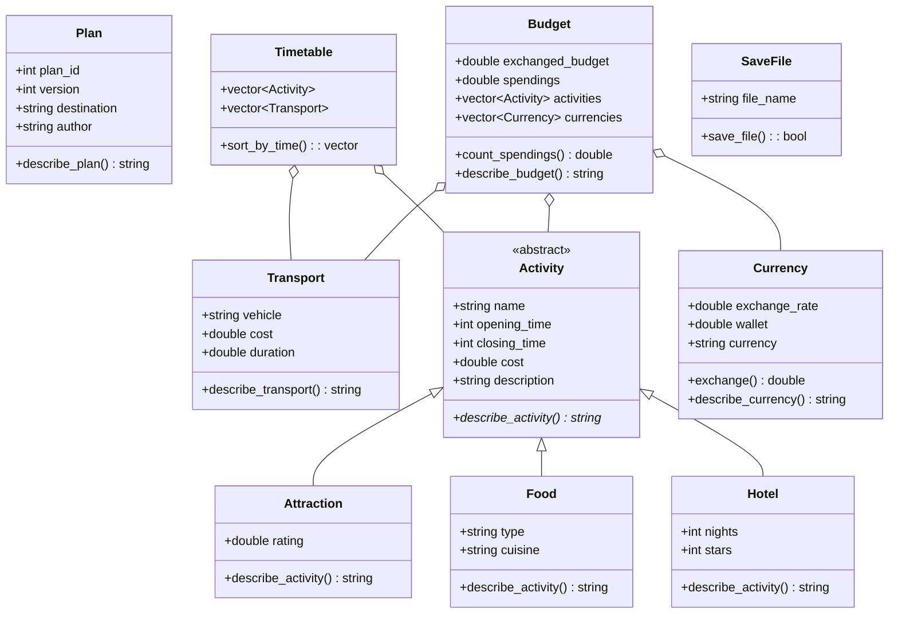

# Trip-Planer
A trip planer which contains several functions that help in organising, counting budget, setting timetable for your holidays. All written in C++

## Object-oriented concept map

|Concept in OOP| Implementation | Why is it used |
|---|---|---|
| Abstraction | class  `Activity` has method `virtual std::describe() =  0` | Different types of `Activity` are performed differently |
| Polymporphism | `Food::describe() = type + 'at' + place + 'costs' + cost` and `Hotel::describe() = 'nights' + nights + 'at' + 'name' + 'costs' + cost`| Each type of `Activity` demands different `description` |
| Composition | `std::vector<std::unique_ptr<Activity>> activities` |`Budget` is composed of costs generated from different `Activities`|
| Error Handling | if (`spendings` > `exchanged_wallet`) is True throw `std::invalid_argument` | `Budget` cannot be negative |
| Error Handling | `Activities::describe()= ''` throw `std::inavlid_argument` | `description` of an `Activity` cannot be empty |

`Class Diagram`

